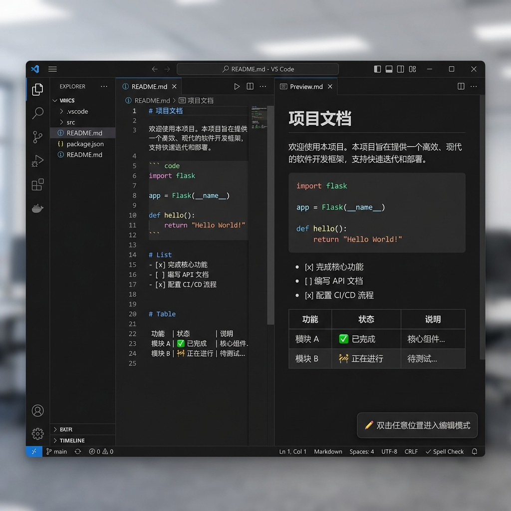
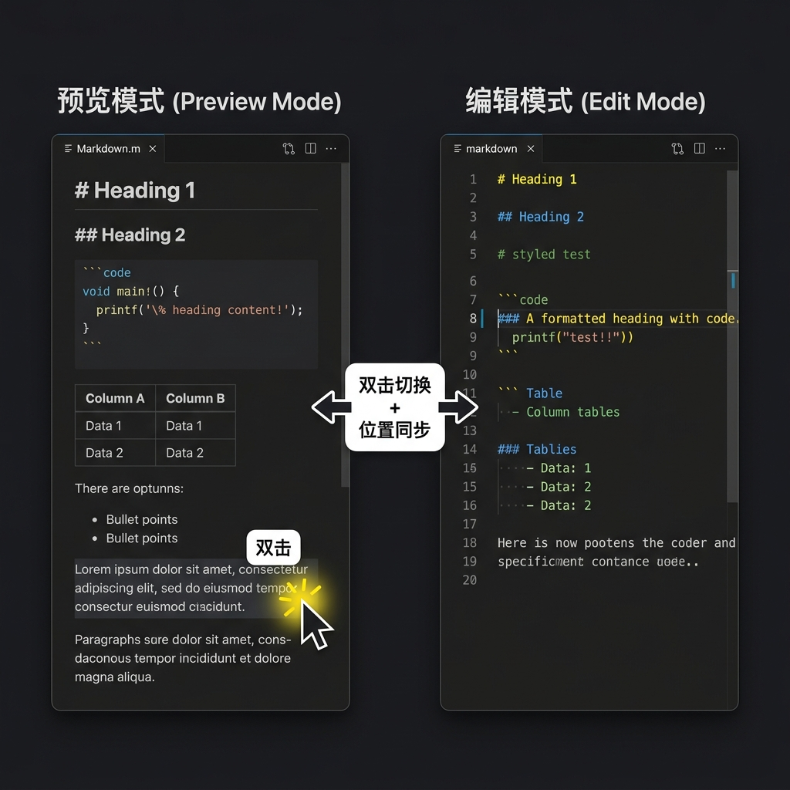

# Markdown 即时渲染预览

> 打开 `.md` 文件即刻看到渲染结果，双击在预览 / 编辑之间无缝切换，光标位置精准同步。

## ✨ 核心特性

### 📖 打开即预览

安装后，所有 `.md` / `.markdown` 文件默认以 **渲染视图** 打开 —— 告别左右分栏，所见即所得。

### 🖱️ 双击切换，位置同步

| 场景 | 操作 | 效果 |
|------|------|------|
| 预览模式 → 编辑模式 | 双击预览中的任意位置 | 打开文本编辑器，光标自动跳转到对应的 Markdown 源码行 |
| 编辑模式 → 预览模式 | 双击编辑器中的任意位置 | 切回渲染预览，自动滚动到对应位置并高亮闪烁 |

不再需要手动找位置 —— 预览到哪就编辑到哪，编辑到哪就预览到哪。

### 🎨 GitHub 风格主题

- **暗色 / 亮色自适应**：自动跟随 VS Code 主题切换
- **高对比度兼容**：支持 VS Code 高对比度主题
- 完整的 GFM（GitHub Flavored Markdown）支持：表格、任务列表、删除线、代码块高亮

### 📋 一键复制代码

鼠标悬停在代码块上，右上角出现 **「复制」** 按钮，点击即可将代码复制到剪贴板。

---

## 🚀 安装

### 方式一：从 VSIX 文件安装

1. 下载 `.vsix` 文件
2. 打开 VS Code / Cursor / Antigravity
3. `Ctrl+Shift+P` → 输入 **"从 VSIX 安装"** 或 **"Install from VSIX"**
4. 选择下载的 `.vsix` 文件
5. 重新加载编辑器

### 方式二：从插件市场安装

在扩展面板搜索 **"Markdown 即时渲染预览"** 并安装。

---

## 📘 使用方法

### 基本操作

| 操作 | 快捷方式 |
|------|---------|
| 查看 Markdown 渲染结果 | 直接打开任意 `.md` 文件 |
| 预览中切换到编辑 | **双击**预览中的任意位置 |
| 编辑中切换到预览 | **双击**编辑器中的任意位置 |
| 复制代码块 | 悬停代码块 → 点击右上角「复制」 |

### 命令面板

按 `Ctrl+Shift+P`（macOS: `Cmd+Shift+P`）打开命令面板，可用命令：

| 命令 | 说明 |
|------|------|
| `Markdown 预览: 切换到编辑模式` | 从渲染预览切换到文本编辑器 |
| `Markdown 预览: 切换到预览模式` | 从文本编辑器切换回渲染预览 |

### 编辑器标题栏按钮

- 在预览模式下，标题栏显示 ✏️ **编辑** 按钮
- 在编辑模式下，标题栏显示 👁️ **预览** 按钮

---

## ⚙️ 配置选项

| 配置项 | 默认值 | 说明 |
|--------|--------|------|
| `mdPreview.theme` | `"github"` | 渲染主题样式（当前支持 GitHub 风格，后续可扩展） |

---

## 🔧 兼容性

| 编辑器 | 支持状态 |
|--------|---------|
| VS Code | ✅ 完全兼容 |
| Cursor | ✅ 完全兼容 |
| Antigravity | ✅ 完全兼容 |
| 其他 VS Code 衍生产品 | ✅ 理论兼容 |

**最低版本要求**：VS Code 1.74.0+

---

## 🏗️ 技术栈

| 组件 | 技术 |
|------|------|
| Markdown 解析 | [marked](https://github.com/markedjs/marked) v12 |
| 代码高亮 | [highlight.js](https://highlightjs.org/) v11 |
| 构建工具 | [esbuild](https://esbuild.github.io/) |
| 编辑器 API | VS Code Custom Editor API (`CustomTextEditorProvider`) |

### 位置同步原理

1. **预览 → 编辑**：渲染时为每个块级 HTML 元素注入 `data-source-line` 属性（对应 Markdown 源码行号），双击时查找最近的行号标记，切换后将光标跳转到该行
2. **编辑 → 预览**：监听编辑器的选择变更事件，检测到双击（500ms 内同一行两次鼠标选择）后切换到预览，并通知 Webview 滚动到对应位置

---

## 📝 更新日志

### v1.2.0

- 🔧 重构：彻底重写行号注入算法，修复长文档中双击切换位置不对应的问题
- ✅ 使用 marked lexer 的 token 列表精确定位源码行号，消除旧版累积偏移
- ✅ 优化嵌套结构（引用块、嵌套列表）的行号计算精度
- ✅ 新增 Webview 就绪握手机制，确保大文件切换时滚动消息在 DOM 渲染完成后发送
- ✅ 改进滚动定位算法：当精确行号无对应元素时，支持前后标记间线性插值
- ✅ 改进行号估算：从滚动百分比估算改为最近标记元素查找

### v1.1.1

- 🔧 修复：优化发布配置，完善 Open VSX 市场部署元数据

### v1.1.0

- ✅ 新增：编辑模式双击切换回预览模式
- ✅ 修复：预览模式双击进入编辑模式时位置不对应的问题
- ✅ 新增：双向位置同步（预览 ↔ 编辑）
- ✅ 新增：切换时目标位置高亮闪烁动画
- ✅ 新增：暗色 / 亮色主题下的高亮动画适配

### v1.0.0

- 🎉 初始发布
- 打开 Markdown 文件默认显示渲染预览
- 双击预览切换到编辑模式
- GitHub 风格主题（暗色 / 亮色自适应）
- 代码块一键复制
- GFM 完整支持（表格、任务列表、删除线等）
- highlight.js 代码语法高亮

---

## 📄 许可证

MIT

---

**反馈和建议**：欢迎在 GitHub Issues 中反馈问题或提出功能建议。
